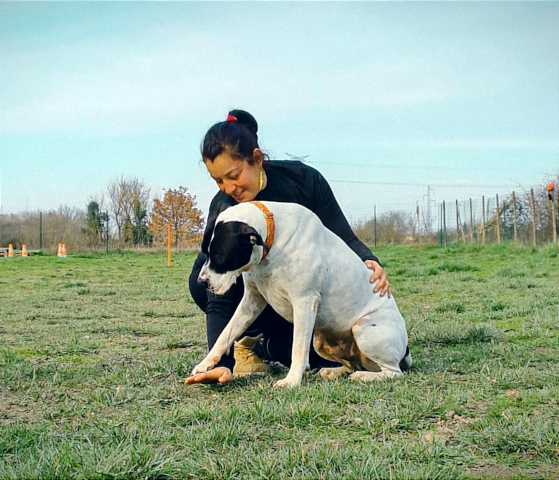
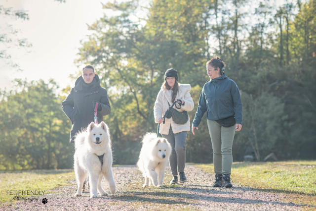
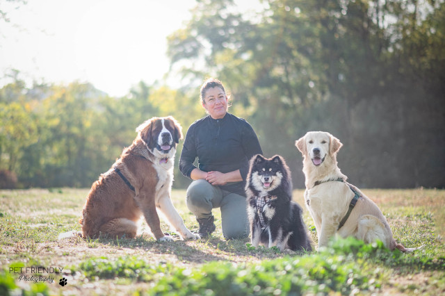
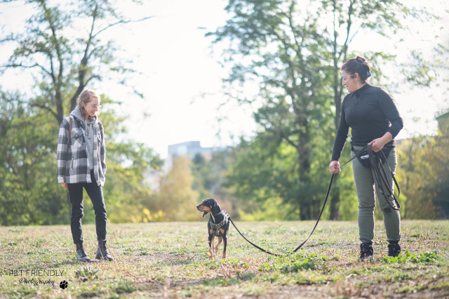

# Mes services d'éducation canine, de dogsitting et de prévention des morsures

Pour **chiots** ou bien **chiens adultes**, quels que soient leurs besoins, leur histoire ou leurs problématiques: amélioration du quotidien, prévention des difficultés, construction d'une relation plus sereine. Je me déplace à ton domicile la plupart du temps, pour voir évoluer le chien dans son environnement réel.

---

## Éducation canine et comportement du chien {#education-canine}

Je propose un accompagnement en **éducation canine positive**, basé sur la compréhension du chien, le respect de ses émotions et un suivi adapté à ton mode de vie.

🐾 Éducation et rééducation du chien, bases éducatives du chiot  
🐾 Étude du comportement et accompagnement personnalisé  
🐾 Chien réactif: peureux, agressif, mordeur, surexcité... 
🐾 Séances individuelles et cours collectifs  

Tu veux comprendre ce que j'entend par "méthode basée sur l'encouragement et la coopération"? Va voir là:

  <a class="bouton-vert" href="{{ '/pourquoi-faire-appel/' | relative_url }}">Pourquoi faire appel à moi&nbsp;?</a>

  

Ton chien est réactif (excitation, fuite, agression, morsures...) ? Va voir là pourquoi je suis compétente pour t'aider:   

  <a class="bouton-vert" href="{{ '/qui-suis-je/' | relative_url }}">Tao, le chien qui a tout changé & mes formations&nbsp;?</a>

### Le bilan comportemental du chien

Le bilan comportemental est le premier rendez-vous indispensable avant toute séance d'éducation.  
Il permet de poser des bases solides et adaptées à ton chien, à ton environnement et à ton quotidien.

Objectifs du bilan :

- apprendre à te connaître, toi, ton chien et votre cadre de vie
- comprendre vos besoins et vos difficultés
- définir un **plan de travail personnalisé**

🐾 Durée : environ 1h30  
🐾 Lieu : à ton domicile

---

### La séance d'éducation canine individuelle

Les séances d'éducation peuvent être réalisées à l'unité ou dans le cadre d'un forfait.  
Chaque séance est adaptée à l'évolution de ton chien et à vos objectifs.

Une séance comprend :

- un temps d'échange pour répondre à tes questions
- l'évaluation des exercices précédemment proposés
- de nouveaux exercices et/ou un travail de décryptage du comportement

🐾 Durée : environ 1h
🐾 Lieu : domicile, quartier, parc... selon les besoins  

---

### Les ateliers collectifs

Attention, ces séances ne sont accessibles qu'aux chiens en suivi individuel, ou au minimum ayant fait un bilan comportemental avec moi. 
De plus, je décide si l'atelier proposé convient au chien lors de son inscription.   

Il existe différents types d'ateliers ou activité collectives, mais toujours en nombre très limité (4 à 6 chiens maxi)

- Les ateliers chiots: socialisation, apprentissages, jeux (je privilégie des interactions calmes, les ateliers chiots ne sont pas 1h d'excitation entre eux où ils n'apprennent rien).  
- Les cours collectifs/balades éducatives et sociales: cotoyer ses congénères, des humains, sans jamais être forcé de jouer ou d'être caliné (si ton chien préfère juste faire pipi sur 1000 poteaux et jamais jouer, c'est OK), des exercices pour mettre en pratique ce qu'on fait en séance individuelle.  
- Les ateliers réactifs: 4 chiens maxi, on travaille ce qu'on voit en séance individuelle, sans mise en contact des chiens. On leur laisse le temps, l'espace nécessaire pour apprendre dans de bonnes conditions

🐾 Durée : environ 1h
🐾 Lieu : parc, zone nature (forêt/campagne)... selon les besoins  

---

### Le suivi premium

Si tu ne te sens pas à l'aise pour travailler seul·e entre les séances, le suivi premium permet un accompagnement renforcé et plus régulier.

Ce suivi inclut :

- un accompagnement plus fréquent, voire quotidien si nécessaire
- des ajustements précis en fonction de l'évolution
- une progression plus encadrée

🐾 Durée : environ 30 minutes
🐾 Lieu : domicile, quartier, parc...

  <a class="bouton-vert" href="{{ '/tarifs/#tarifs-education-canine' | relative_url }}">Voir mes tarifs éducation</a>

---

## Dogsitting et promenades de chiens à Saint-Étienne {#dogsitting-promenade}

Je propose également des prestations de **dogsitting et de promenades**, ponctuelles ou régulières, adaptées à ton organisation et aux besoins de ton chien.

Services proposés :

- garde à domicile
- balades individuelles ou collectives
- accueil centre aéré pour chiens

🐾 Durée : de 30 minutes à plusieurs heures  
🐾 Lieu : domicile, quartier, parc, forêt...

  <a class="bouton-vert" href="{{ '/tarifs/#tarifs-dogsitting-et-promenades' | relative_url }}">Voir mes tarifs dogsitting</a>

---

## Prévention des morsures, le Programme PECCRAM {#prevention-des-morsures}

Le Programme d'Éducation à la Connaissance du Chien et au Risque d'Accident par Morsure (PECCRAM) créé par Chantal Hazard (FIMAC), vise à **prévenir les accidents par morsure**, notamment auprès des **enfants de 4 à 10 ans**, en leur apprenant à :

- reconnaître le langage canin
- adopter les bons comportements face à un chien

Les interventions peuvent comprendre jusqu'à 6 séances avec un même groupe.

### Déroulé d'une séance PECCRAM

- présentation du thème
- activité pratique pour intégrer une gestuelle
- jeu de rôle

🐾 Durée : environ 1h  
🐾 Lieu : écoles, centres sociaux, structures périscolaires...

Quelques chiffres clés :

- 50 % des enfants de 3 à 5 ans confondent un chien stressé et joyeux
- avec une éducation adaptée : seulement 17 % d'erreurs
- 1/3 des morsures concernent des enfants de moins de 10 ans
- zones les plus touchées : visage, crâne, cou

  <a class="bouton-vert" href="{{ '/tarifs/#tarifs-prevention-morsures' | relative_url }}">Voir mes tarifs PECCRAM</a>

---

### Pourquoi faire appel à Canislupa&nbsp;?

- Approche respectueuse du chien
- Accompagnement personnalisé et progressif
- Interventions à domicile à Saint-Étienne et alentours
- Expérience en éducation, comportement et prévention

Tu peux également retrouver mes informations sur diverses plateformes d'**éducateur canin**  
👉 [proxianimaux](https://www.proxianimaux.fr/acteur/1570)  
👉 [rintintin](https://rintintin-booking.com/pro/canislupa)  

Besoin d'un premier échange&nbsp;?  
👉 [Me contacter]({{ "/" | relative_url }})  

Accompagnements: **Saint-Étienne** et alentours (Firminy, Roche-la-Molière, Villars, La Talaudière, Saint-Jean-Bonnefond, Planfoy...)  

---

[← Retour à l'accueil]({{ "/" | relative_url }})

